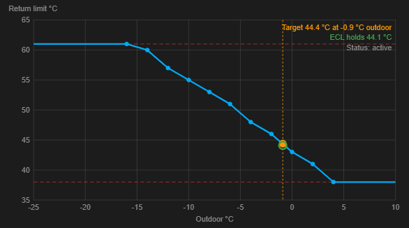
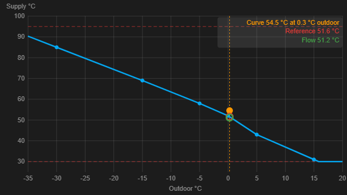

# ECL 120/220 Modbus for Home Assistant

Home Assistant integration for **Danfoss ECL 120 and ECL 220** heating controllers over **Modbus RTU** or **Modbus TCP**.

- Tested on ECL 120, application `A130`
- ECL 220 uses the same register map but is untested
- Not affiliated with or endorsed by Danfoss


## Features
- Reads and writes ECL registers as normal entities: sensors, numbers, selects and switches
- Serial (USB to RS485) or TCP through a Modbus gateway, with automatic reconnect
- Register groups that can be turned on or off together
- **Return limit curve**: makes the fixed return limit follow the outdoor temperature
- **Charts** of the supply (heat) curve and the return limit curve

## Install

### HACS
[HACS](https://hacs.xyz) is a community add-on, not part of Home Assistant. With HACS installed:

1. **HACS** → **⋮** → **Custom repositories** → add `https://github.com/grigals/ha-ecl-modbus` as type **Integration**.
2. Download **ECL Modbus** and restart Home Assistant.
3. **Settings** → **Devices & services** → **Add integration** → **ECL Modbus**.

[](https://my.home-assistant.io/redirect/hacs_repository/?owner=grigals&repository=ha-ecl-modbus&category=integration)

### Manual
Copy `custom_components/ecl_modbus` from the latest release into `/config/custom_components/`, restart Home Assistant, then add the integration as in step 3.

## Connection

| Setting | Serial (Modbus RTU) | TCP (Modbus gateway) |
|---|---|---|
| Port | e.g. `/dev/serial/by-id/...` | `502` |
| Baud rate | `38400` | Gateway RS485 side: `38400` |
| Parity | `Even` | `Even` |
| Data bits | `8` | `8` |
| Stop bits | `1` | `1` |
| Slave / unit ID | `5` | `5` |

Tested with Hi-Flying Protoss-PE11. Dual device setup.

## Registers
Every register is an entity. Only a core set starts enabled, and disabled registers are not polled.

- **Single entities:** enable or disable them on the device page.
- **Whole groups:** **Configure** → tick or untick the group. Changes apply after about 30 seconds.
- **Polling interval:** also under **Configure** (default `30` s).

| Group | Contents |
|-------|----------|
| **Temperatures** | S1–S6, outside, flow, return, room, supply, DHW |
| **Status and alarms** | Valve, pump, operation mode and status, heat demand, bypass, alarms |
| **Boost** | On/off, remaining time, period, added temperature |
| **Setpoints** | Flow limits and references, room, summer cut-out, frost protection, bypass |
| **Weather curve** | Curve slope and curve points |
| **PID tuning** | Xp, Tn, deadband |
| **Return and room limiters** | Limiter influence and adaption time |
| **Pump and valve exercise** | After-run and exercise timing |
| **Feature switches** | Limiters, summer cut-out, frost protection, exercise, bypass, external override |
| **Sensor health** | S1–S6 OK, invalid, open or short circuit |
| **Device information** | Serial, firmware, IP and MAC, runtime, Modbus counters |

All registers are defined in [`registers.py`](custom_components/ecl_modbus/registers.py). Addresses follow the ECL 120 `A130` map; other applications use some of them differently.

## Return limit curve
The ECL 120 has one fixed return limit, register `21210`. This feature makes it follow the outdoor temperature, like the ECL 210/310. It is off by default.

**Set up:**
1. **Configure** → tick **Configure the return limit curve next**.
2. Enter the settings below.
3. Check the preview table and leave **Turn the return limit curve on** ticked.

The **Return limit curve** switch on the device page turns it on or off later.

| Setting | Default | Notes |
|---------|---------|-------|
| Curve points | `-15:55, 10:40` | `2` to `12` `outdoor:limit` pairs in °C. Linear between points, flat beyond the ends. |
| Outdoor sensor | ECL register `21102` | Or any Home Assistant temperature sensor |
| Averaging | `24` h | Mean outdoor temperature over this period; `0` uses the current value |
| Lowest limit | `25` °C | The written value is cut to this range |
| Highest limit | `65` °C | |

**How it writes:**
- Only changes of `1` K or more, at most every `30` minutes.
- Each write is read back on the next poll. If it didn't stick, a repair issue is raised.
- Nothing is written while the outdoor temperature is unavailable.
- If `21210` is changed elsewhere (ECL Go, the controller, the entity), the curve pauses with a repair issue. Turn the switch off and on to resume.
- While the curve is on, `21210` and `21102` are polled even if their entities are disabled.

> [!IMPORTANT]
> **Fail-safe:** the ECL keeps the last value written. If Home Assistant stops, the controller carries on with that limit. Set a fixed limit before you turn the curve off for good.

The sensor **Return limit (calculated)** shows the target. Its attributes show the outdoor average, active segment, status and last write.

## Charts
Two image entities on the device page. Add them to a dashboard with a **Picture entity** card.

### Return limit curve chart
The curve, the min/max limits (dashed red), the target at the averaged outdoor temperature (orange) and the value the ECL holds (green).



### Supply curve chart
The ECL heat curve from its six points (`-30` to `15` °C, registers `21232`–`21242`), continued beyond them and cut to the supply min/max (`21202`, `21204`). At the current outdoor temperature (`21102`) it marks:
- what the curve asks for, `21206` (orange)
- the reference after limiters, `21200` (red)
- the actual flow temperature, `21100` (green)



Its registers are polled while the chart is enabled. Change the curve itself in ECL Go or on the controller.

## Tests
Run on real Home Assistant with a fake Modbus client. Needs Linux, WSL or Docker.

```bash
pip install -r requirements_test.txt
pytest
```

## License
[MIT](LICENSE). Use at your own risk; see the [disclaimer](DISCLAIMER.md).

## Credits
Forked from [nichlasrohde/ha-ecl-modbus](https://github.com/nichlasrohde/ha-ecl-modbus), the original integration.
