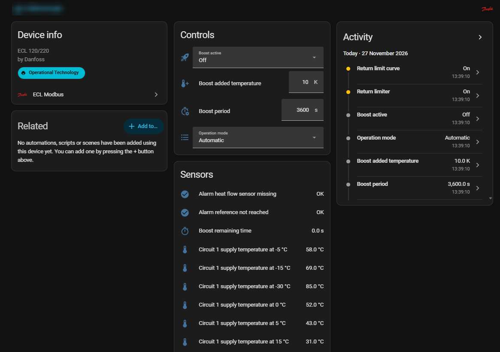

# ECL 120/220 Modbus for Home Assistant

Home Assistant integration for **Danfoss ECL 120 and ECL 220** heating controllers over **Modbus RTU or Modbus TCP**. Tested on ECL 120 (application A130). ECL 220 uses the same register map but is untested.

Forked from [nichlasrohde/ha-ecl-modbus](https://github.com/nichlasrohde/ha-ecl-modbus). Not affiliated with or endorsed by Danfoss.



## Features
- Reads and writes the ECL registers as normal entities: sensors, numbers, selects and switches
- Serial (USB to RS485) or TCP through a Modbus gateway; reconnects on its own
- Register groups that can be turned on or off together
- **Return limit curve**: makes the fixed return limit follow the outdoor temperature
- **Charts** of the supply (heat) curve and the return limit curve

## Install
**HACS** ([hacs.xyz](https://hacs.xyz)) is a community add-on, not part of Home Assistant. With HACS installed:

1. HACS → **⋮** → **Custom repositories** → add `https://github.com/grigals/ha-ecl-modbus` as type **Integration**.
2. Download **ECL Modbus** and restart Home Assistant.
3. **Settings → Devices & services → Add integration → ECL Modbus**.

[](https://my.home-assistant.io/redirect/hacs_repository/?owner=grigals&repository=ha-ecl-modbus&category=integration)

**Manually:** copy `custom_components/ecl_modbus` from the latest release into `/config/custom_components/`, restart, then add the integration as in step 3.

## Connection
| | Serial (Modbus RTU) | TCP (Modbus gateway) |
|---|---|---|
| Port | e.g. `/dev/serial/by-id/...` | 502 |
| Settings | 38400 baud, even parity, 1 stop bit | Gateway's RS485 side set the same |
| Slave / unit ID | 5 | 5 |

Tested with a USB to RS485 converter, a WaveShare RS485 to Ethernet/WiFi server and a Hi-Flying Protoss-PE11.

## Registers
Every register is an entity. Only a core set starts enabled, and disabled registers are not polled. Enable single entities on the device page, or whole groups under **Configure**. Changes apply after about 30 seconds. The polling interval is also under **Configure**.

| Group | Contents |
|-------|----------|
| Temperatures | S1–S6, outside, flow, return, room, supply, DHW |
| Status and alarms | Valve, pump, operation mode and status, heat demand, bypass, alarms |
| Boost | On/off, remaining time, period, added temperature |
| Setpoints | Flow limits and references, room, summer cut-out, frost protection, bypass |
| Weather curve | Curve slope and curve points |
| PID tuning | Xp, Tn, deadband |
| Return and room limiters | Limiter influence and adaption time |
| Pump and valve exercise | After-run and exercise timing |
| Feature switches | Limiters, summer cut-out, frost protection, exercise, bypass, external override |
| Sensor health | S1–S6 OK, invalid, open or short circuit |
| Device information | Serial, firmware, IP and MAC, runtime, Modbus counters |

All registers are defined in [`registers.py`](custom_components/ecl_modbus/registers.py). Addresses follow the ECL 120 A130 map; other applications use some of them differently.

## Return limit curve
The ECL 120 has one fixed return limit (register 21210). This makes it follow the outdoor temperature, like the ECL 210/310. It is off by default.

**Set up:** **Configure** → tick **Configure the return limit curve next** → enter the settings → check the preview table → leave **Turn the return limit curve on** ticked. The **Return limit curve** switch turns it on or off later.

| Setting | Default | |
|---------|---------|---|
| Curve points | `-15:55, 10:40` | 2 to 12 `outdoor:limit` pairs in °C. Linear between points, flat beyond the ends. |
| Outdoor sensor | ECL (21102) | Or any Home Assistant temperature sensor |
| Averaging | 24 h | Mean outdoor temperature over this period; 0 = current value |
| Lowest / highest limit | 25 / 65 °C | The written value is cut to this range |

**Writing:**
- Writes only changes of 1 K or more, at most every 30 minutes.
- Reads each write back on the next poll and raises a repair issue if it didn't stick.
- Writes nothing while the outdoor temperature is unavailable.
- If 21210 is changed elsewhere (ECL Go, the controller, the entity), the curve pauses with a repair issue. Turn the switch off and on to resume.
- While on, 21210 and 21102 are polled even if their entities are disabled.

**Fail-safe:** the ECL keeps the last value written. If Home Assistant stops, it carries on with that limit. Set a fixed limit before you turn the curve off for good.

The sensor **Return limit (calculated)** shows the target, with attributes for the outdoor average, active segment, status and last write.

## Charts
Two image entities on the device page. Add them to a dashboard with a *Picture entity* card.

**Return limit curve chart:** the curve, the min/max limits (dashed red), the target at the averaged outdoor temperature (orange) and the value the ECL holds (green).


**Supply curve chart:** the ECL heat curve from its six points (−30 to 15 °C), continued beyond them and cut to supply min/max. At the current outdoor temperature it marks:
- what the curve asks for (orange)
- the reference after limiters (red)
- the actual flow temperature (green)

Its registers are polled while the chart is enabled. Change the curve itself in ECL Go or on the controller.

## Tests
Run on real Home Assistant with a fake Modbus client. Needs Linux, WSL or Docker:

```bash
pip install -r requirements_test.txt
pytest
```

## Documentation
[ECL120 & ECL220 Modbus Specification, rev 023](./docs/IS2007%2C%20ECL120%20and%20ECL220%20Modbus%20Specification%2C%20rev%20023.pdf), shared with permission from Danfoss.

## License and disclaimer
MIT. Provided as-is, without warranty. Writing to the controller changes how the heating runs. Check registers and values before writing, and use at your own risk.
